  

  
  
  
  
  
  
  
  

---

# 🚀 Awesome Task Queues & Background Jobs

A curated collection of industry-leading **SaaS platforms**, **serverless schedulers**, and **open-source task queue frameworks** for executing asynchronous workloads, background workers, event-driven pipelines, and durable distributed workflows.

Task queues and background job orchestrators enable modern web applications, microservices, and AI pipelines to offload non-blocking, time-consuming operations—such as sending transactional emails, generating PDF reports, processing video/audio files, orchestrating long-running LLM agent calls, and running cron schedules—safely ensuring automatic retries, fault tolerance, and concurrency control.

---

## 📑 Table of Contents

- [📊 Sector Overview & Market Dynamics](#-sector-overview--market-dynamics)
- [☁️ SaaS & Hosted Platforms](#️-saas--hosted-platforms)
- [💻 Open-Source GitHub Projects](#-open-source-github-projects)
- [🧭 Architecture & Selection Matrix](#-architecture--selection-matrix)
- [🤝 How to Contribute](#-how-to-contribute)
- [💖 Support & Sponsoring](#-support--sponsoring)
- [📈 Star History](#-star-history)
- [⚠️ Disclaimer](#️-disclaimer)

---

## 📊 Sector Overview & Market Dynamics

The global message queuing, background processing, and durable workflow orchestration market is estimated at **$16.5 billion in 2025** and is projected to surpass **$38.2 billion by 2030**, compounding at a **18.3% CAGR**. Growth is heavily accelerated by distributed microservice topologies, event-driven architectures (EDA), serverless computing, and long-running AI workflow orchestration.

From a market dynamics perspective, the sector exhibits **bifurcated concentration**:
- **Message Transport Layer (Highly Concentrated):** Foundational cloud message queuing and pub/sub transport is dominated by hyperscalers (**AWS**, **Microsoft Azure**, and **Google Cloud**), which capture the majority of pure ingestion volume due to tight cloud infrastructure lock-in.
- **Workflow & Background Job Execution Layer (Moderately Fragmented):** Application-level task runners, durable code-as-workflow engines, and language-native queues are **moderately fragmented**. Independent pioneers (**Temporal**, **Sidekiq**, **BullMQ**, **Celery**, **Inngest**, **Trigger.dev**) compete vigorously for developer mindshare through superior local developer experience (DX), state durability, zero-polling architectures, and native language ergonomics.

---

## ☁️ SaaS & Hosted Platforms

The following hosted platforms provide managed queuing, serverless task dispatch, and durable cloud workflows with zero infrastructure maintenance. The table is **sorted descending by company scale (market valuation / annual revenue)**.

| 🏢 Platform / Provider | 🏛️ Company Scale (Valuation / Revenue) | 🎁 Free Tier Limit (Specific) | 💰 Starting Tier Pricing (Specific) | 🎯 Best For / Key Capabilities |
| :--- | :--- | :--- | :--- | :--- |
| **[Azure Service Bus](https://azure.microsoft.com/en-us/products/service-bus/)** *(Microsoft)* | **~$3.1 Trillion** Market Cap (~$245B ARR) | **Azure Free Account: 750 hours & 1,000,000 message operations free for 12 months** (Basic/Standard) | **$0.05 per million operations** + **$10.00/month** base unit (Standard); Premium starts at **$677.00/month** (1 MU, 99.99% SLA) | Enterprise AMQP 1.0 messaging, session ordered delivery, transactional processing, and deep Azure ecosystem integration. |
| **[Google Cloud Pub/Sub](https://cloud.google.com/pubsub)** *(Alphabet)* | **~$2.2 Trillion** Market Cap (~$350B ARR) | **10 GB message throughput free per month** (free forever under Google Cloud Always Free) | **$40.00 per TiB** (~$0.04/GB; ~$10.00/mo for 1M standard 10KB messages); ordering keys and schema validation included | Globally distributed, zero-ops pub/sub with automatic multi-zone replication, push/pull endpoints, and 99.95% SLA. |
| **[AWS SQS](https://aws.amazon.com/sqs/)** *(Amazon AWS)* | **~$2.0 Trillion** Market Cap (~$575B ARR) | **1,000,000 API requests free every month** (free forever under AWS Free Tier) | **$0.40 per million requests** (Standard Queues); **$0.50 per million requests** (FIFO Queues with strict deduplication) | High-volume, virtually infinite-scale queuing with Dead-Letter Queues (DLQ) and native AWS Lambda event integration. |
| **[Cloudflare Queues](https://developers.cloudflare.com/queues/)** *(Cloudflare)* | **~$38 Billion** Market Cap (~$1.5B ARR) | **1,000,000 operations free per month** on Workers Paid; or 10,000 operations/month on Workers Free | **$0.40 per million operations** (requires Cloudflare Workers Paid plan starting at **$5.00/month**) | Low-latency globally distributed queuing natively integrated into Cloudflare Workers edge compute runtime. |
| **[Temporal Cloud](https://temporal.io/)** *(Temporal Technologies)* | **~$1.5 Billion** Valuation ($120M+ funding; Sequoia, Index) | **30-day free trial with $1,000 in usage credits** (no upfront credit card commitment) | Consumption pricing: **$0.000042 per Action** (~$42.00 per 1M actions) + **$0.042 per GB-hour active storage** | Mission-critical durable execution for long-running, fault-tolerant workflows with human-in-the-loop steps. |
| **[Inngest Cloud](https://www.inngest.com/)** *(Inngest)* | **~$45 Million** Valuation ($9M+ funding; GGV, a16z) | **Free forever plan: 25,000 step runs/month**, 3 team seats, and 3-day step history | **Pro Plan: $25.00/month** (includes 250,000 step runs/mo; $0.10 per additional 1,000 step runs) | Serverless event-driven durable functions, step functions, and retries with zero worker pool provisioning. |
| **[Upstash QStash](https://upstash.com/docs/qstash)** *(Upstash)* | **~$35 Million** Valuation ($3.1M+ funding) | **Free forever plan: 1,000 messages/day (~30,000/month)**, max payload 1MB | **Pay-as-you-go: $1.00 per 100,000 messages** (free retries); **Team plan at $180.00/month** (1M messages/day) | Serverless HTTP message queuing and webhook scheduler; delivers payload straight to REST/HTTP endpoints. |
| **[Trigger.dev Cloud](https://trigger.dev/)** *(Trigger.dev)* | **~$25 Million** Valuation ($3.5M+ funding; Y Combinator S23) | **Free forever plan: 50,000 successful runs/month**, unlimited team members, 7-day log retention | **Pro Plan: $50.00/month** (includes 250,000 successful runs/mo; $0.0002 per additional run) | Full-stack background jobs, real-time logging, and long-running tasks built specifically for TypeScript and Next.js. |

---

## 💻 Open-Source GitHub Projects

Self-hosted open-source solutions provide complete data sovereignty, zero per-message cloud fees, and granular operational control over queuing infrastructure.

The list below is **sorted descending by GitHub stargazer count**.

- **[Celery](https://github.com/celery/celery)**   
  *Language:* **Python** | *Brokers:* RabbitMQ, Redis, Amazon SQS  
  The de facto standard asynchronous distributed task queue for Python. Backed by a battle-tested BSD-3-Clause open-source codebase with no licensing fees. Powers large-scale production workloads across Django, Flask, FastAPI, and Pyramid. Features task retries, ETA/countdown scheduling, task canvas (chains, chords, groups), rate-limiting, and pluggable result backends.

- **[Temporal](https://github.com/temporalio/temporal)**   
  *Language:* **Go / Polyglot SDKs (Go, TypeScript, Python, Java, .NET, PHP)** | *Storage:* PostgreSQL, MySQL, Cassandra, SQLite  
  A modern durable execution engine for orchestrating microservices, long-running business workflows, and distributed transactions without manual state management. Workflows are authored as standard imperative code; Temporal automatically restores execution state after node failures, server reboots, or network partitions.

- **[Trigger.dev](https://github.com/triggerdotdev/trigger.dev)**   
  *Language:* **TypeScript / Node.js** | *Storage:* PostgreSQL  
  Open-source background jobs framework designed for TypeScript developers. Solves serverless timeouts (e.g. Vercel 15s limit) by allowing long-running tasks without infrastructure lock-in. Includes automatic retries, real-time web dashboard, step-level observability, and support for AI prompt streaming.

- **[Bull](https://github.com/OptimalBits/bull)**   
  *Language:* **Node.js / JavaScript** | *Broker:* Redis  
  The classic, highly popular Redis-based task queue for Node.js. Features atomic operations via Redis Lua scripts, delayed jobs, scheduled cron jobs, parent-child job dependencies, concurrency limits per worker, and pause/resume capabilities.

- **[RabbitMQ](https://github.com/rabbitmq/rabbitmq-server)**   
  *Language:* **Erlang** | *Protocols:* AMQP 0-9-1, AMQP 1.0, MQTT 5.0, STOMP  
  The world's most widely deployed open-source multi-protocol message broker (MPL 2.0). Provides complex message routing (direct, topic, fanout, headers), message acknowledgments, quorum queues for high-availability clustering, dead-letter exchanges, and cross-datacenter federation.

- **[Asynq](https://github.com/hibiken/asynq)**   
  *Language:* **Go** | *Broker:* Redis  
  Simple, reliable, and efficient distributed task queue library for Go. Designed around Redis with minimal memory overhead. Features guaranteed at-least-once delivery, scheduled/delayed task execution, weighted priority queues, task deduplication, automatic retries with exponential backoff, and a dedicated CLI and web monitoring UI.

- **[Sidekiq](https://github.com/sidekiq/sidekiq)**   
  *Language:* **Ruby / Rails** | *Broker:* Redis  
  The gold standard background job framework for Ruby on Rails. Uses multithreading to process thousands of jobs simultaneously in a single process, slashing memory consumption compared to multi-process alternatives. Open-source core provides basic queuing; commercial editions (Sidekiq Pro & Enterprise) offer reliable fetch, rate-limiting, and unique jobs.

- **[RQ (Redis Queue)](https://github.com/rq/rq)**   
  *Language:* **Python** | *Broker:* Redis  
  A lightweight, easy-to-learn Python library for queuing jobs and processing them in the background with worker processes. Built strictly on Redis, RQ features a minimal learning curve, clean codebase, delayed jobs, worker timeouts, and seamless integration with web frameworks.

- **[BullMQ](https://github.com/taskforcesh/bullmq)**   
  *Language:* **TypeScript / Node.js** | *Broker:* Redis / Redis Cluster  
  The modern rewrite and official successor to Bull, built from the ground up in TypeScript with support for Redis Cluster. Operates completely without polling to maintain near-zero idle CPU usage. Features parent-child job hierarchies, repeatable/cron jobs, manual step progression, rate limiters, token-based locks, and sandbox worker threads.

- **[Hatchet](https://github.com/hatchet-dev/hatchet)**   
  *Language:* **Go, Python, TypeScript** | *Storage:* PostgreSQL, RabbitMQ  
  A distributed, fault-tolerant task queue and workflow engine designed to replace legacy message queues. Offers sub-second dispatch latencies, concurrency throttling, step-level DAG execution, cron scheduling, and deep real-time observability across services.

- **[Faktory](https://github.com/contribsys/faktory)**   
  *Language:* **Polyglot (Go server with Ruby, Python, Node, Go, Rust clients)** | *Storage:* RocksDB  
  Created by Mike Perham (author of Sidekiq), Faktory acts as a centralized background job server that speaks a simple JSON-over-TCP protocol. Allows any programming language to publish and consume background tasks through a single unified daemon.

- **[Inngest Core](https://github.com/inngest/inngest)**   
  *Language:* **Go / TypeScript** | *Storage:* PostgreSQL, Redis  
  The open-source durable execution engine powering Inngest Cloud. Allows developers to write step functions, background queues, and delayed workflows locally without managing worker pools or server polling loops.

- **[River](https://github.com/riverqueue/river)**   
  *Language:* **Go** | *Storage:* PostgreSQL  
  Fast, modern background job queue for Go backed natively by PostgreSQL. Solves the dual-write problem by executing job enqueueing and database modifications inside the same database transaction. Features high-performance batch operations, LISTEN/NOTIFY low-latency dispatch, periodic jobs, and rescue handling.

- **[Dramatiq](https://github.com/Bogdanp/dramatiq)**   
  *Language:* **Python** | *Brokers:* RabbitMQ, Redis  
  A fast, high-throughput, and reliable alternative to Celery for Python 3. Prioritizes simplicity, thread-safety, lower memory overhead, and resilience against broker crashes. Provides automatic retries, rate limiters, and thread-based worker processes.

- **[Oban](https://github.com/oban-bg/oban)**   
  *Language:* **Elixir** | *Storage:* PostgreSQL, SQLite  
  Robust background job processing for Elixir and the Phoenix framework, powered natively by PostgreSQL. Leverages PostgreSQL notifications and transactions to guarantee transactional job scheduling without external broker dependencies.

- **[Laravel Workflow](https://github.com/durable-workflow/workflow)**   
  *Language:* **PHP / Laravel** | *Broker:* Laravel Queue Drivers (Redis, SQS, DB)  
  Durable workflow engine for PHP powered directly by Laravel Queues, inspired by Temporal and Azure Durable Functions. Enables writing long-running, fault-tolerant business workflows with pause/resume and state durability inside standard Laravel apps.

- **[Nuvom](https://github.com/nahom-zewdu/Nuvom)**   
  *Language:* **Python** | *Broker:* Brokerless / SQLite  
  Lightweight, plugin-first task queue for Python with zero external Redis or broker dependencies. Features native Windows compatibility, AST-based static task discovery, manifest caching, and Prometheus metrics integration.

- **[Quebec](https://github.com/ratazzi/quebec)**   
  *Language:* **Python** | *Storage:* PostgreSQL  
  PostgreSQL-backed task queue for Python with automatic package-level job discovery, priority queues, delayed job execution, and an integrated web control dashboard running on `127.0.0.1:5006`.

---

## 🧭 Architecture & Selection Matrix

Choosing the optimal task queue depends on your language ecosystem, broker infrastructure tolerance, and durability requirements:

| Architecture Pattern | Representative Tools | Primary Advantages | Considerations & Trade-offs |
| :--- | :--- | :--- | :--- |
| **Redis-Backed Queues** | BullMQ, Sidekiq, Celery, Asynq, RQ | Extremely high throughput (10k+ ops/sec), sub-millisecond dispatch, minimal latency. | In-memory storage requires Redis persistence tuning (AOF/RDB) to prevent data loss on crash. |
| **PostgreSQL-Native Queues** | River (Go), Oban (Elixir), Quebec (Python) | Eliminates dual-write problem; enqueue jobs inside the same DB transaction as business data. | High queue volume can cause database bloat; requires autovacuum tuning and table pruning. |
| **Dedicated Message Brokers** | RabbitMQ, Apache Kafka, NATS | Advanced protocol support (AMQP, MQTT), complex routing keys, clustering, high durability. | Additional operational footprint; requires dedicated cluster maintenance and monitoring. |
| **Durable Execution Engines** | Temporal, Inngest, Hatchet, Trigger.dev | Code-as-workflow, automatic crash recovery, multi-step orchestration, human-in-the-loop. | Paradigm shift from simple fire-and-forget queues; steeper initial learning curve. |
| **Cloud Managed Queues** | AWS SQS, GCP Pub/Sub, Azure Service Bus | Zero maintenance, virtually unlimited horizontal scaling, enterprise security & compliance. | Per-message cloud consumption costs, vendor lock-in, higher dispatch latency (~10–30ms). |

---

## 🤝 How to Contribute

Contributions from developers, platform engineers, and open-source maintainers are warmly welcome!

1. 🍴 **Fork** this repository.
2. 🌿 **Create a branch** for your addition (`git checkout -b feature/add-new-queue`).
3. 📝 **Add your entry** under either SaaS or Open-Source in alphabetical or relevant order:
   - Provide the tool name, project URL, and exact pricing/license.
   - For open-source projects, include the star badge:  
     ``
4. 🧪 Ensure all markdown links and formatting render cleanly.
5. 🚀 **Submit a Pull Request** with a brief summary of the project.

---

## 💖 Support & Sponsoring

If you find this curated directory helpful for architecting background workers and distributed systems, please consider supporting the project!

- ⭐ **Star this repository** to help other engineers discover it.
- 🍴 **Fork & Share** it with your developer community, colleagues, and team.
- ☕ **Sponsor or Buy a Coffee:** Support ongoing maintenance and curation on the [GitHub Sponsors Dashboard](https://github.com/sponsors/ishandutta2007).

  

---

## 📈 Star History

---

## ⚠️ Disclaimer

- This repository is a **community-curated index** provided for informational and educational purposes only. Mention of products or projects does not constitute an official endorsement.
- Cloud pricing tiers, API quotas, and SaaS plan limits are subject to change by their respective providers. Always verify terms on the vendor's official pricing page.
- **Idempotency notice:** Background job retries are not idempotent by default. Application handlers should always be implemented with idempotency keys or safe transactional operations to avoid duplicate side effects upon worker restarts.

---

  Made with ❤️ for backend engineers, platform teams, and developers building reliable asynchronous architectures.

